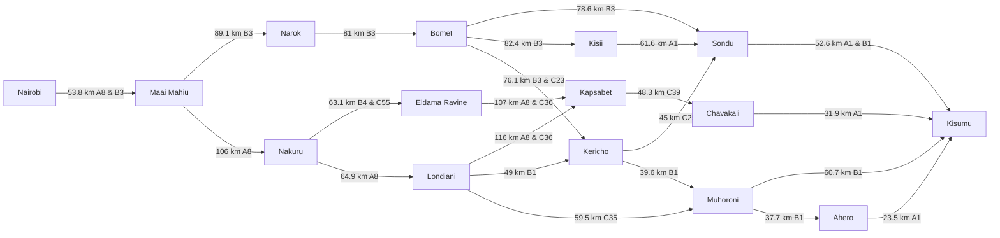
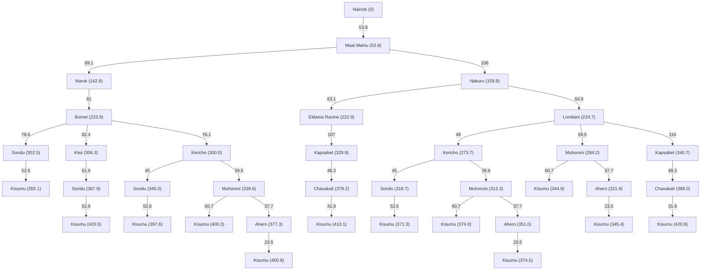

# Self-driving Trailer Agent travelling from Nairobi to Kisumu

## PEAS Framework Design
**Performance Measure** - Path Cost, Cargo & Trailer condition, Traffic rules obedience.
**Environment** - Kenya's Highway Network, Road traffic, GPS Information, Traffic rules, Weather Conditions.
**Actuators** - Steering wheel, Brakes, Accelerator, Indicators.
**Sensors** - Kenya's Road Map database, GPS, Cameras, Speed sensors, Fuel sensors, Collision detectors, Weather info.

## Agent Environment Definitions
1. **Partially Observable** - The agent can't perceive ahead of other traffic, nor through bad weather conditions and turns.
2. **Stochastic** - Road traffic and weather conditions are unpredictable.
3. **Sequential** - Current driving actions and decisions such as which routes are taken affect the  future states.
4. **Dynamic** - The environmental state such as weather and traffic changes as the agent is deciding and acting on it.
5. **Multi-agent** - The trailer agent interacts with other vehicles in its environment.

##### Nodes considered
1. Nairobi 
2. Maai Mahiu
3. Narok
4. Nakuru
5. Bomet
6. Eldama Ravine
7. Londiani
8. Kapsabet
9. Kericho
10. Muhoroni
11. Chavakali
12. Sondu
13. Kisii
14. Ahero
15. Kisumu

### Edges combined with Path Costs
| From          | To            | Distance (km) | Road(s)  |
| ------------- | ------------- | ------------- | -------- |
| Nairobi       | Maai Mahiu    | 53.8          | A8 & B3  |
| Maai Mahiu    | Narok         | 89.1          | B3       |
| Maai Mahiu    | Nakuru        | 106           | A8       |
| Narok         | Bomet         | 81            | B3       |
| Nakuru        | Eldama Ravine | 63.1          | B4 & C55 |
| Eldama Ravine | Kapsabet      | 107           | A8 & C36 |
| Nakuru        | Londiani      | 64.9          | A8       |
| Londiani      | Kapsabet      | 116           | A8 & C36 |
| Londiani      | Kericho       | 49            | B1       |
| Londiani      | Muhoroni      | 59.5          | C35      |
| Kapsabet      | Chavakali     | 48.3          | C39      |
| Chavakali     | Kisumu        | 31.9          | A1       |
| Bomet         | Sondu         | 78.6          | B3       |
| Bomet         | Kisii         | 82.4          | B3       |
| Bomet         | Kericho       | 76.1          | B3 & C23 |
| Sondu         | Kisumu        | 52.6          | A1 & B1  |
| Kisii         | Sondu         | 61.6          | A1       |
| Kericho       | Sondu         | 45            | C25      |
| Kericho       | Muhoroni      | 39.6          | B1       |
| Muhoroni      | Kisumu        | 60.7          | B1       |
| Muhoroni      | Ahero         | 37.7          | B1       |
| Ahero         | Kisumu        | 23.5          | A1       |

## Directed Graph

## Search Tree

**Note on Abstraction:** The nodes, and subsequently the paths selected, are the ones we found most suitable and logical for the journey. Any irrelevant nodes e.g. Eldoret, Oyugis which weren't chosen do not appear in the graph, tree nor path cost calculations.
## Optimal Path from Nairobi to Kisumu

**Path cost function:** Sum of distances between consecutive towns (in km).

The directed graph produces the following simple directed paths from Nairobi to Kisumu.

| #   | Path                                                                                  | Calculation (km)                             | Total (km)         |
| --- | ------------------------------------------------------------------------------------- | -------------------------------------------- | ------------------ |
| 1   | Nairobi -> Maai Mahiu -> Nakuru -> Londiani -> Muhoroni -> Kisumu                     | 53.8 + 106 + 64.9 + 59.5 + 60.7              | **344.9**(fastest) |
| 2   | Nairobi -> Maai Mahiu -> Nakuru -> Londiani -> Muhoroni -> Ahero -> Kisumu            | 53.8 + 106 + 64.9 + 59.5 + 37.7 + 23.5       | 345.4              |
| 3   | Nairobi -> Maai Mahiu -> Narok -> Bomet -> Sondu -> Kisumu                            | 53.8 + 89.1 + 81 + 78.6 + 52.6               | 355.1              |
| 4   | Nairobi -> Maai Mahiu -> Nakuru -> Londiani -> Kericho -> Sondu -> Kisumu             | 53.8 + 106 + 64.9 + 49 + 45 + 52.6           | 371.3              |
| 5   | Nairobi -> Maai Mahiu -> Nakuru -> Londiani -> Kericho -> Muhoroni -> Kisumu          | 53.8 + 106 + 64.9 + 49 + 39.6 + 60.7         | 374.0              |
| 6   | Nairobi -> Maai Mahiu -> Nakuru -> Londiani -> Kericho -> Muhoroni -> Ahero -> Kisumu | 53.8 + 106 + 64.9 + 49 + 39.6 + 37.7 + 23.5  | 374.5              |
| 7   | Nairobi -> Maai Mahiu -> Narok -> Bomet -> Kericho -> Sondu -> Kisumu                 | 53.8 + 89.1 + 81 + 76.1 + 45 + 52.6          | 397.6              |
| 8   | Nairobi -> Maai Mahiu -> Narok -> Bomet -> Kericho -> Muhoroni -> Kisumu              | 53.8 + 89.1 + 81 + 76.1 + 39.6 + 60.7        | 400.3              |
| 9   | Nairobi -> Maai Mahiu -> Narok -> Bomet -> Kericho -> Muhoroni -> Ahero -> Kisumu     | 53.8 + 89.1 + 81 + 76.1 + 39.6 + 37.7 + 23.5 | 400.8              |
| 10  | Nairobi -> Maai Mahiu -> Nakuru -> Eldama Ravine -> Kapsabet -> Chavakali -> Kisumu   | 53.8 + 106 + 63.1 + 107 + 48.3 + 31.9        | 410.1              |
| 11  | Nairobi -> Maai Mahiu -> Narok -> Bomet -> Kisii -> Sondu -> Kisumu                   | 53.8 + 89.1 + 81 + 82.4 + 61.6 + 52.6        | 420.5              |
| 12  | Nairobi -> Maai Mahiu -> Nakuru -> Londiani -> Kapsabet -> Chavakali -> Kisumu        | 53.8 + 106 + 64.9 + 116 + 48.3 + 31.9        | 420.9(slowest)     |

The least-cost path is:
**Nairobi -> Maai Mahiu -> Nakuru -> Londiani -> Muhoroni -> Kisumu**

**Total cost:**  
53.8 + 106 + 64.9 + 59.5 + 60.7 = **344.9 km**

This is the optimal route because it has the lowest cumulative path cost among all possible paths from Nairobi to Kisumu. 